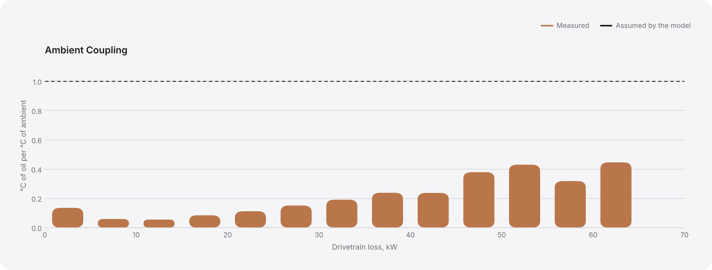
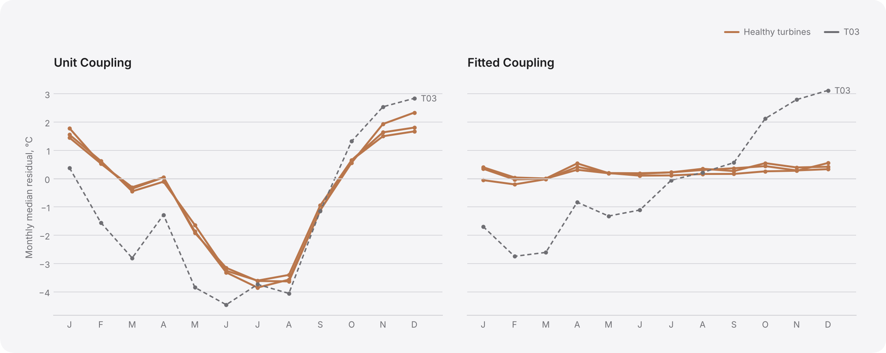
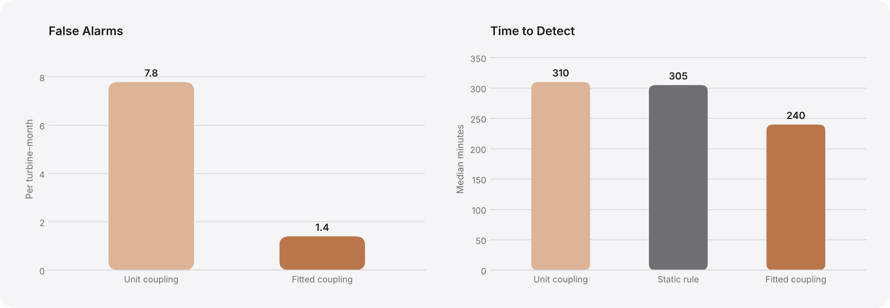

# Gearbox Thermal Model

A study of the gearbox oil model in [wind-twin](https://github.com/twinedge-ai/wind-twin), TwinEdge's open wind farm digital twin, measured on the same public ENGIE La Haute Borne SCADA archive. wind-twin predicts the oil temperature from drivetrain loss and outdoor temperature, and alarms when the measurement runs above the prediction. Its training report notes that a static fleet-median rule usually catches slow overheating first. This study traces much of that to one assumption in the steady state, that the oil follows the outdoor temperature one for one, and measures what changes when the coupling is fitted from data instead. Out of sample, the residual spread halves, false alarms fall from 7.8 to 1.4 per turbine-month, and a slow drift is detected 70 minutes sooner. A patch applies the same change to wind-twin's Rust code, and all of its physics tests pass with it.

## The Physics

wind-twin's steady state adds a load-driven rise to the outdoor temperature:

$$T_{ss} = T_{amb} + f(P_{loss})$$

with the loss heat taken from the electrical power and a drivetrain efficiency of 97%, $P_{loss} = (1-\eta)\,P/\eta$. The oil then approaches the steady state as a first-order system, with separate rates for heating and cooling:

$$T_{n+1} = T_n + \alpha\,(T_{ss} - T_n)$$

The gearbox oil runs through a thermostatically controlled cooler. A cooler that holds the oil near its set point passes on only part of a change in outdoor temperature, so the coupling should be well below 1. The archive shows exactly that.

<p>
<picture>
  <source media="(prefers-color-scheme: dark)" srcset="docs/images/coupling-dark.png">
  
</picture>
<br>
<sub><b>Ambient coupling.</b> Change in gearbox oil temperature per degree of outdoor temperature, fitted by least squares within each 5 kW band of drivetrain loss across the four turbines in 2017. The model assumes 1.0 (dashed). The archive shows 0.06 to 0.45, rising with load.</sub>
</p>

With the coupling fixed at 1, every change in weather the cooler absorbs lands in the residual. The fitted steady state keeps wind-twin's form and lets the coupling follow the data:

$$T_{ss} = a(P_{loss}) + k(P_{loss})\,T_{amb}, \qquad 0 \le k \le 1$$

Everything else stays as wind-twin has it: the loss model, the dynamics fit, open-loop deployment with slow bias adaptation, and the alarm rules.

## How It Performs

Each model is fitted on one season and tested on the rest of 2017, in two splits: fitted April to June and tested July to December, then fitted October to December and tested January to September. T01, T02 and T04 are the healthy turbines. wind-twin's own report treats T03 as genuinely hot.

| | Unit coupling | Fitted coupling |
| :-- | :-- | :-- |
| Residual standard deviation, healthy turbines | 2.75 °C | 1.48 °C |
| 99th percentile absolute residual | 8.61 °C | 4.43 °C |
| Residual alarms on healthy turbines, per turbine-month | 7.8 | 1.4 |
| Fitted heating to cooling rate ratio | 4.2 | 0.65 |

<p>
<picture>
  <source media="(prefers-color-scheme: dark)" srcset="docs/images/bias-dark.png">
  
</picture>
<br>
<sub><b>Seasonal bias.</b> Monthly median of the out-of-sample residual for each turbine through 2017, each month taken from the split that did not fit on it. With unit coupling the healthy turbines swing from +2 °C in winter to −4 °C in summer, which is the weather. With the coupling fitted they stay within half a degree of zero, and T03 separates from the fleet, its residual climbing from July to December.</sub>
</p>

The drift test grafts wind-twin's design fault, a rise of 1.5 °C per hour, onto the healthy turbines at 174 start times, every three days through both test windows. Each model runs wind-twin's residual rule (more than 4 °C for six frames) against its static rule (5 °C above the fleet median for three frames).

| | Unit coupling | Fitted coupling | Static rule |
| :-- | :-- | :-- | :-- |
| Drifts detected within 12 h | 97.1% | 100% | 100% |
| Median time to detect | 310 min | 240 min | 305 min |
| Detected before the static rule | 41% | 67% | |
| Median lead over the static rule | −20 min | +60 min | |

<p>
<picture>
  <source media="(prefers-color-scheme: dark)" srcset="docs/images/drift-dark.png">
  
</picture>
<br>
<sub><b>Alarms and detection.</b> Residual alarms on the healthy turbines per turbine-month, and the median time to detect the grafted drift across 174 trials. With the coupling fitted, the residual rule raises a fifth of the false alarms and fires an hour before the static rule in a typical trial.</sub>
</p>

Two further observations follow from the corrected physics. Under unit coupling, the heating rate comes out about four times faster than the cooling rate. With the coupling fitted, the two are similar, so that asymmetry came largely from the ambient term rather than the oil. And with the weather removed, T03's rising residual matches what wind-twin's report says about it. That is an observation, not a diagnosis.

## How It Was Built

**Reading the model before the data.** The study started in wind-twin's `thermal.rs`, by writing out its steady state as an equation and asking what a thermostatic cooler would do to it. The coupling was then measured directly from the archive before any model was refitted, so the change rests on what the data shows.

**One change, everything else held.** The comparison only means something if nothing else moves. The loss model, the dynamics fit, the open-loop deployment with its adaptation rate of 0.03 per interval, and both alarm rules are ported from wind-twin's code as written. The two variants differ only in the coupling.

**Honest out-of-sample tests.** Each model is fitted on one season and tested on the others, in both directions, so summer is never tested on a model fitted in summer. The residual is taken before the bias adaptation, so every expected value is a prediction from past data only.

**A drift test from the model's own design.** The grafted fault is the one wind-twin's tests use, 1.5 °C per hour, raced against the rule its report says usually wins. Grafts that would cross a gap in the record are skipped.

**A patch that keeps old models valid.** `docs/wind-twin-fitted-ambient-coupling.patch` adds the fitted coupling to `crates/twin-physics/src/thermal.rs`, with one line in `enrich.rs` and a new test. A model saved before the change has no couplings stored, which means k = 1, so it behaves exactly as before. With the patch, all 33 `twin-physics` tests pass, including wind-twin's real-data plausibility check and its drift test, and so do `cargo clippy -D warnings` and `cargo fmt --check`.

## How to Reproduce It

```bash
git clone https://github.com/iamabdirazak/gearbox-thermal-model.git
cd gearbox-thermal-model
python3 -m venv .venv && source .venv/bin/activate
pip install -r requirements.txt

python -m src.evaluation.score          # fetches the archive once, writes results/
for f in coupling bias drift; do python -m src.visualization.$f; done
```

The archive is streamed once and cut to the nine columns used here, about 18 MB on disk instead of 187 MB.

To apply the patch to wind-twin, from the folder that holds both repositories:

```bash
git clone https://github.com/twinedge-ai/wind-twin && cd wind-twin
git apply ../gearbox-thermal-model/docs/wind-twin-fitted-ambient-coupling.patch
cargo test -p twin-physics
```

## Limitations

- One farm and one year of data, with drifts grafted onto real records rather than labelled failures.
- The archive's own outdoor temperature is the ambient input. wind-twin uses Open-Meteo, or the nacelle temperature less a fitted offset, when that column is absent.
- The fit holds while the cooler works normally. Cold starts with an oil heater, standstill and a cooler fault change the regime, and a load band with less than 5 °C of ambient spread keeps k = 1.
- The patch was tested with Rust 1.97. wind-twin pins 1.93.1.

## Data

ENGIE La Haute Borne open data, CC BY 4.0, via Mendeley Data, DOI 10.17632/vmyg4yp3s8.1. Turbine names follow wind-twin's farm layout.

## License

The code is released under the MIT License.

## Author

Abdirazak Mubarak, November 2026
